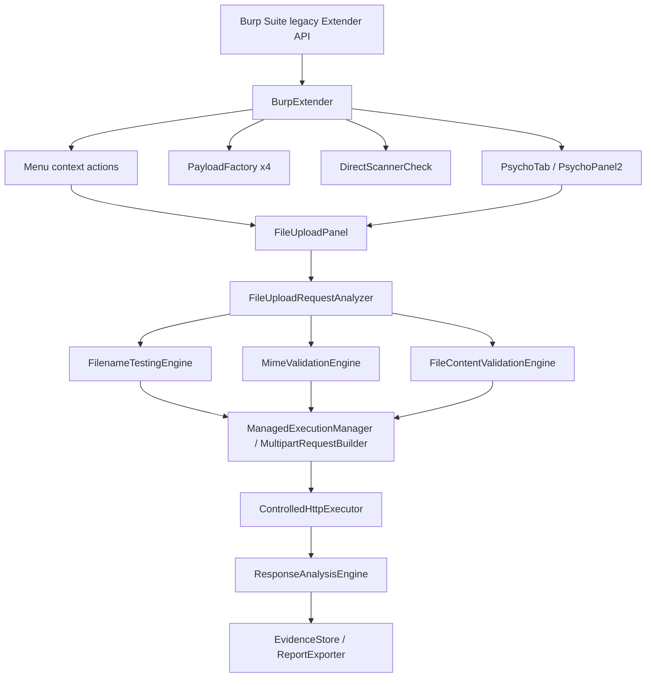

# PathHunter — Master Documentation

**Canonical technical reference for the entire PathHunter project.**  
Update this file whenever features, architecture, tests, build, or roadmap change.  
**Do not** create separate Markdown files per phase or subphase.

| Item | Value |
| --- | --- |
| Project | PathHunter |
| Repository | https://github.com/Amirbarkhordari/PathHunter |
| Maintainer | Amir Barkhordari |
| License | GPL-3.0 (`LICENSE`; provenance in `NOTICE`) |
| Primary branch | `master` |
| Current phase | **4.5** complete — Managed prepare (4.5.1), controlled HTTP (4.5.2), response analysis (4.5.3), evidence/results (4.5.4) |
| Latest documented feature commit | see [§11](#11-development-history) (Phase 4.5) |
| Entry class | `uk.co.pentest.psychoPATH.BurpExtender` |
| Distribution artifact | `dist/PathHunter.jar` |
| Document status | Living master (supersedes former per-phase docs directory) |

**Status labels used in this document:** `IMPLEMENTED` · `PARTIALLY IMPLEMENTED` · `PLANNED` · `NOT IMPLEMENTED` · `NOT VERIFIED` · `DEPRECATED`

---

## Table of contents

1. [Project Overview](#1-project-overview)
2. [Project Architecture](#2-project-architecture)
3. [Installation and Configuration](#3-installation-and-configuration)
4. [Core Features](#4-core-features)
5. [File Upload Security Testing Architecture](#5-file-upload-security-testing-architecture)
6. [File Upload Test Case Architecture](#6-file-upload-test-case-architecture)
7. [Managed Execution Architecture](#7-managed-execution-architecture)
8. [Security and Safety Design](#8-security-and-safety-design)
9. [Testing Architecture](#9-testing-architecture)
10. [Development Roadmap](#10-development-roadmap)
11. [Development History](#11-development-history)
12. [Known Limitations](#12-known-limitations)
13. [Contribution and Development Workflow](#13-contribution-and-development-workflow)

---

## 1. Project Overview

### Purpose

PathHunter is an independently maintained **Burp Suite** Java extension for authorized security testing of:

- Path traversal / local file inclusion (LFI) / arbitrary file read
- File-upload path and metadata validation gaps
- Controlled generation of path and upload test candidates for Intruder and (future) managed execution

### Target users

Web application security testers and penetration testers working in authorized scopes (including PortSwigger Web Security Academy labs and systems they own or are contracted to test).

### Current development status

| Area | Status |
| --- | --- |
| Path traversal / LFI Intruder generators | `IMPLEMENTED` |
| Absolute path & URL-encoding engines | `IMPLEMENTED` (opt-in; labs `NOT VERIFIED`) |
| File Upload Analyzer + Filename / MIME / Content planners | `IMPLEMENTED` |
| Managed request preparation (4.5.1) | `IMPLEMENTED` (in-memory; never transmits) |
| Controlled HTTP execution (4.5.2) | `IMPLEMENTED` (explicit auth; Burp `makeHttpRequest`) |
| Response analysis (4.5.3) | `IMPLEMENTED` (behavioral; not auto-vuln severity) |
| Evidence / results / report export (4.5.4) | `IMPLEMENTED` |
| Burp desktop GUI load of current JAR | `NOT VERIFIED` in automation |
| PortSwigger Academy live labs | `NOT VERIFIED` in automation |

### Technology

- Java sources compiled with `javac --release 8` (bytecode major version **52**)
- Legacy Burp Extender API (`IBurpExtender`) — **not** Montoya
- Swing GUI
- No bundled `burp/` API classes in `dist/PathHunter.jar`

---

## 2. Project Architecture

### High-level data flow



### Package layout

| Path | Package | Role |
| --- | --- | --- |
| `Java/src/uk/co/pentest/*.java` | `uk.co.pentest.psychoPATH` | Core extension, path engines, Intruder, scanner, main UI |
| `Java/src/uk/co/pentest/fileupload/*.java` | `…fileupload` | Upload analyze / plan engines |
| `Java/src/uk/co/pentest/fileupload/execution/*.java` | `…fileupload.execution` | Managed preparation (4.5.1) |
| `tools/smoke/` | mostly `uk.co.pentest.psychoPATH` | Regression harness (not shipped in JAR) |
| `dist/PathHunter.jar` | — | Distribution artifact |
| `Java/psychoPATH.jar` | — | Historical binary (untouched; not the PathHunter dist) |

Directory folder names omit `psychoPATH`; class files emit under `uk/co/pentest/psychoPATH/…`.

### Burp integration

| Concern | Implementation |
| --- | --- |
| Entry | `BurpExtender` implements `IBurpExtender`, `IExtensionStateListener` |
| Suite tab | Caption **PathHunter** via `PsychoTab` |
| Intruder | Factories: Byte, Directory checker, Path traversal, Payload marker |
| Context menu | Scope propagate; **Send to PathHunter File Upload Analyzer** |
| Scanner | Optional `DirectScannerCheck` (LFI-style literal matches) |

### Swing GUI architecture

- Primary configuration: `PsychoPanel2` (global settings, webroots, traversal, evasive, encodings, absolute paths, URL encoding, byte generator, save/export)
- File Upload: nested tabbed UI inside `FileUploadPanel` — Analyzer · Filename Testing · MIME Testing · Content Testing · Managed Testing
- Long work uses `SwingWorker`; UI updates on EDT

---

## 3. Installation and Configuration

### Requirements

| Requirement | Notes |
| --- | --- |
| Burp Suite | Tested compile classpath: Professional desktop jar (e.g. 2026.4.3) |
| JDK for rebuild | JDK with `--release 8` (documented: JDK 24 on maintainer machine) |
| Runtime | Burp’s JVM loads `dist/PathHunter.jar` |

### Build (`IMPLEMENTED`)

Working directory: repository root.

```text
javac --release 8 -encoding UTF-8 -Xlint:-options ^
  -cp <path-to-burpsuite_desktop.jar> ^
  -d build\classes ^
  Java\src\uk\co\pentest\*.java ^
  Java\src\uk\co\pentest\fileupload\*.java ^
  Java\src\uk\co\pentest\fileupload\execution\*.java

jar --create --file dist\PathHunter.jar --manifest build\MANIFEST.MF -C build\classes .
```

- Ant `Java/build.xml` imports missing `nbproject/` — **not** used.
- Do not modify `Java/psychoPATH.jar`.
- Verify: bytecode major **52**; no `burp/` classes inside the JAR.

### Install in Burp

1. Extensions → Add → type **Java**
2. Select `dist/PathHunter.jar`
3. Expect name **PathHunter**, tab **PathHunter**, Intruder generators listed above

Load-failure background (Phase 0.1): Burp 2026 blocks non-allowlisted types in package `burp`; entry must be `uk.co.pentest.psychoPATH.BurpExtender`. Details retained historically in `docs/burp-loading-fix.md`.

### Troubleshooting

| Symptom | Check |
| --- | --- |
| Extension fails to load | Entry class / package; JAR not bundling Burp API |
| Empty path payloads | LFI mode / empty lists / Absolute or URL Encoding disabled |
| File Upload empty | Paste or send a full raw HTTP request with body |
| Managed prepare fails | Generate & select plan cases; content cases need content artifacts |

---

## 4. Core Features

### Global Settings / Webroot / Traversal / Evasive / Save — `IMPLEMENTED` / `PARTIALLY IMPLEMENTED`

Configured in `PsychoPanel2` and consumed by `IntruderPayloadGenerator`:

- Document-root lists (nix / Windows / app servers), `{TARGET}` substitution (`PARTIALLY IMPLEMENTED` — label-split / null site-map defects)
- Traversal depth, slashes, evasive sequences, break bytes (`IMPLEMENTED`)
- Output encodings RAW / URL / double-URL / UTF variants (`PARTIALLY IMPLEMENTED` — double-URL quirks)
- Payload export / clipboard (`IMPLEMENTED`; export uses scanner-mode file names)
- Payload marker (`IMPLEMENTED`)

### Byte Generator — `PARTIALLY IMPLEMENTED`

`IntruderPayloadGeneratorByte`: six ranges; global encoding loop on byte output not fully wired.

### Absolute Paths — `IMPLEMENTED`

| Item | Detail |
| --- | --- |
| Class | `AbsolutePathEngine` |
| UI | Absolute paths tab (opt-in, **off by default**) |
| Strategies | `ABSOLUTE_LINUX`, `ABSOLUTE_WINDOWS`, `ABSOLUTE_CUSTOM` (+ existing `STANDARD_TRAVERSAL`) |
| Behavior | Bare absolute paths (e.g. `/etc/passwd`) without `../` / webroot prefixes; encodings applied once via existing tables |
| Intruder | Augments **Path traversal** generator when enabled — not a separate factory |
| Tests | `AbsolutePathSmoke` **33/33** |
| Labs | PortSwigger absolute-path bypass lab: `NOT VERIFIED` |

### URL Encoding — `IMPLEMENTED`

| Item | Detail |
| --- | --- |
| Class | `UrlEncodingEngine` |
| UI | URL Encoding tab (opt-in, **off by default**) |
| Strategies | Single/double/triple encoded traversal, mixed encode, mixed separators, case variants, combined depths |
| Depth | Default max **2**, hard cap **5**; payload hard cap **400** |
| Preview | Local decode-stage simulation only (no network) |
| Independence | Separate from legacy Evasive `encodingsEnabled` pipeline (by design) |
| Tests | `UrlEncodingSmoke` **31/31** |
| Labs | Superfluous URL-decode lab: `NOT VERIFIED` |

### LFI / Scanner — `IMPLEMENTED` (remote scan `NOT VERIFIED` in automation)

- Default LFI mode on for Intruder path generator
- `DirectScannerCheck` gated by “Enable Scanner checks”; literal response matches; no redirect following

### File Upload Security Testing — `IMPLEMENTED` (see §§5–7)

Passive analysis + structured plans + in-memory request preparation. **No** automatic uploads or HTTP execution in current code.

---

## 5. File Upload Security Testing Architecture

### Module map

```text
uk.co.pentest.psychoPATH.fileupload
  FileUploadRequestAnalyzer, MultipartParser, FileSignatureInspector
  Filename* / Mime* / FileContent* engines and configs
  FileUploadPanel, UploadRequestResult, UploadPart, UploadTestCase, UploadTestPlan
uk.co.pentest.psychoPATH.fileupload.execution
  ManagedExecutionManager, MultipartRequestBuilder, …
```

### 5.1 Request Analyzer (Phase 4.1) — `IMPLEMENTED`

`FileUploadRequestAnalyzer` + `MultipartParser` + `FileSignatureInspector` + `FileUploadPanel` Analyzer tab.

**Classifications (observable only — not vulnerabilities):**

| Classification | Meaning |
| --- | --- |
| `CONFIRMED_MULTIPART_UPLOAD` | multipart with ≥1 filename-bearing part |
| `POTENTIAL_BINARY_UPLOAD` | binary-like PUT/POST |
| `POTENTIAL_FILE_UPLOAD` | upload-shaped clues / text-only multipart |
| `ORDINARY_REQUEST` | no upload characteristics |
| `MALFORMED_UPLOAD_REQUEST` | multipart declared but unusable |

**Multipart safety:** byte-oriented body parse; line-start delimiters; defensive content copies; limits ≈5 MiB body, 100 parts, 8 KiB header lines.

**Signatures (prefix ≤32 B):** JPEG, PNG, GIF, PDF, ZIP, GZIP, BMP, WEBP, ELF, PE/MZ, else `UNKNOWN`. Recognition ≠ safety.

**Burp:** context menu **Send to PathHunter File Upload Analyzer**.

### 5.2 Filename & Extension Testing (Phase 4.2) — `IMPLEMENTED` (planning)

`FilenameTestingEngine` / `FilenameAnalyzer` / `FilenameVariantGenerator`.

Strategies: multiple extensions, case, trailing characters, filename encoding, whitespace/special, filename parameter, path-separator indicators (overlap noted; traversal deferred to Path Traversal engine).

Limits: default max candidates **120** (hard **400**). Cases: `CATEGORY_FILENAME`, `TARGET_FILENAME`, `NOT_EXECUTED`.

### 5.3 MIME Validation (Phase 4.3) — `IMPLEMENTED` (planning)

`MimeValidationEngine` / `MimeAnalyzer` / `MimeExtensionMapper` / `MimeSignatureComparator` / `MimeVariantGenerator`.

Comparison statuses include `CONSISTENT`, `MIME_EXTENSION_MISMATCH`, `MIME_SIGNATURE_MISMATCH`, `MULTIPLE_INCONSISTENCIES`, `MISSING_MIME`, `INCONCLUSIVE`, etc. Confidence descriptive only. `application/octet-stream` is special-cased.

Strategies: declared/case/parameter/missing-empty/mismatch/custom MIME. Cases: `CATEGORY_MIME`, `TARGET_PART_CONTENT_TYPE` (`MimeVariant.MISSING_SENTINEL` for missing header). Default max candidates **80**.

### 5.4 File Content Validation (Phase 4.4) — `IMPLEMENTED` (planning)

`FileContentValidationEngine` / `FileContentAnalyzer` / `FileStructureValidator` / `FileContentHasher` / `ContentVariantGenerator`.

Bounded structure checks:

| Format | Verified (partial) | Not verified |
| --- | --- | --- |
| PNG | Signature, IHDR, chunk bounds, IEND, optional CRC | Full decode / inflate |
| JPEG | SOI, segment lengths, EOI | Entropy decode |
| GIF | Header, LSD, trailer | LZW |
| PDF | `%PDF-`, `%%EOF` | Interpreter / JS |

Strategies: truncated, required marker, signature alteration, length boundary, malformed metadata. Cases: `CATEGORY_CONTENT`, `TARGET_PART_CONTENT_BYTES` with SHA-256 + in-memory artifacts.

### 5.5 Managed Testing / Request Builder (Phase 4.5.1) — `IMPLEMENTED` (prepare only)

See [§7](#7-managed-execution-architecture). **Preparation never transmits HTTP.**

### 5.6 Controlled HTTP Execution (Phase 4.5.2) — `IMPLEMENTED`

`ControlledHttpExecutor` sends prepared artifacts through `HttpTransport` (`BurpHttpTransport` → `callbacks.makeHttpRequest`). Defaults disabled; requires Enable + Authorize Target + Execute confirmation. Target host must match analyzed/authorized host. Batch limits and inter-request delays enforced. Duplicate preparation IDs blocked. Cancellation honored between cases. HTTP/2 still rejected.

### 5.7 Response Analysis (Phase 4.5.3) — `IMPLEMENTED`

Package `fileupload.response`: `ResponseSnapshot`, `ResponseNormalizer`, `ResponseAnalysisEngine`. Compares baseline vs observed responses; emits `BehaviorIndicator` values and `AnalysisConfidence` (`CONFIRMED_BEHAVIOR`, `POSSIBLE_SECURITY_ISSUE`, `INCONCLUSIVE`, `REJECTED`, `ERROR`). HTTP 200 / acceptance text is **not** treated as storage or RCE proof.

### 5.8 Evidence, Results & Reporting (Phase 4.5.4) — `IMPLEMENTED`

Package `fileupload.evidence`: `EvidenceStore`, `EvidenceRecord`, `UploadTestCaseResult`, `AssessmentReport`, `ReportExporter` (JSON + HTML with redaction). File Upload → **Results** tab filters/inspects evidence and exports reports.

---

## 6. File Upload Test Case Architecture

### Models

| Type | Role |
| --- | --- |
| `UploadTestCase` | One planned mutation |
| `UploadTestPlan` | Batch of cases + optional analysis attachments |
| `UploadRequestResult` | Passive analysis + `getOriginalRequestBytes()` clone |

### Categories and targets (from source)

| Constant | Value |
| --- | --- |
| `CATEGORY_FILENAME` | `FILENAME` |
| `CATEGORY_MIME` | `MIME` |
| `CATEGORY_CONTENT` | `CONTENT` |
| `TARGET_FILENAME` | `FILENAME` |
| `TARGET_PART_CONTENT_TYPE` | `PART_CONTENT_TYPE` |
| `TARGET_PART_CONTENT_BYTES` | `PART_CONTENT_BYTES` |

### Execution status constants (on `UploadTestCase`)

`NOT_EXECUTED`, `QUEUED_FOR_FUTURE_EXECUTION`, `EXECUTING`, `COMPLETED`, `FAILED`, `CANCELLED`, `NOT_APPLICABLE`

Generated planner cases remain **`NOT_EXECUTED`**. Preparation (4.5.1) must **not** set `EXECUTED`.

### Content / integrity fields

- Original / candidate SHA-256 and lengths on content cases
- Content artifacts keyed by test ID in `CandidateContentStore` / plan artifacts map
- Selection flags for user-driven managed preparation

---

## 7. Managed Execution Architecture

Package: `uk.co.pentest.psychoPATH.fileupload.execution` (+ `response`, `evidence`)

| Component | Responsibility | Status |
| --- | --- | --- |
| `ManagedExecutionManager` | Validate/prepare batches; never sends | `IMPLEMENTED` |
| `ControlledHttpExecutor` | Authorized send via `HttpTransport` | `IMPLEMENTED` |
| `BurpHttpTransport` / `RecordingHttpTransport` | Burp send / test double | `IMPLEMENTED` |
| `HttpServiceTarget` | Host/port/https without Burp types | `IMPLEMENTED` |
| `ExecutionStateManager` | Lifecycle transitions | `IMPLEMENTED` |
| `MultipartRequestBuilder` | One-target multipart rebuild | `IMPLEMENTED` |
| `HttpRequestFrame` | HTTP/1.x split/rebuild; reject HTTP/2 | `IMPLEMENTED` |
| `CandidateContentStore` | Hash+length verified candidate bytes | `IMPLEMENTED` |
| `ExecutionAuthorizationPolicy` | Defaults **disabled**; host/confirm/batch/delay | `IMPLEMENTED` |
| `SensitiveHeaderRedactor` | Cookie / Authorization / CSRF redaction | `IMPLEMENTED` |
| `PreparedRequestArtifact` / `RequestDiff` | Immutable prepared request + safe diff | `IMPLEMENTED` |
| `ResponseAnalysisEngine` | Baseline vs observed behavioral analysis | `IMPLEMENTED` |
| `EvidenceStore` / `ReportExporter` | Evidence + JSON/HTML reports | `IMPLEMENTED` |

### Lifecycle

Preparation: `NOT_EXECUTED` → `SELECTED` → `VALIDATING` → `READY_FOR_EXECUTION` | `PREPARATION_FAILED` | `CANCELLED`

Execution: `READY_FOR_EXECUTION` → `EXECUTION_PENDING` → `EXECUTING` → `EXECUTED` | `FAILED` | `CANCELLED` | `REJECTED`

Successful prepare → **`READY_FOR_EXECUTION`** and case status stays **`NOT_EXECUTED`**. Only a successful send sets `EXECUTED` / `COMPLETED`.

### Target isolation

Exactly one of: filename · part Content-Type · part body bytes. Unrelated parts preserved; Content-Length recalculated.

### GUI workflow

1. Context menu **Send to PathHunter File Upload Analyzer** (retains `IHttpService` + baseline response when available)
2. Analyze → generate Filename / MIME / Content plans
3. Managed Testing: Load → Validate → Prepare (in memory)
4. Authorize Target (Enable + confirmation) → Execute Selected Prepared (second confirm dialog)
5. Results tab: filter, inspect evidence, export JSON/HTML

---

## 8. Security and Safety Design

| Control | Behavior |
| --- | --- |
| Original request preservation | Defensive clones; SHA-256 before/after prepare |
| Part content immutability | `UploadPart.getContent()` clones; content candidates copy-only |
| Target isolation | Reject multi-target / bad hash / missing artifact / bad part index |
| Authorization | Policy default disabled; Enable + Authorize Target + Execute confirmation; host/port/method/path/size/batch/delay gates |
| Sensitive data | Do not log Cookie / Authorization / CSRF; GUI/report redaction |
| Multipart | Byte-safe rebuild; reject unsafe HTTP/2 forms rather than silent downgrade |
| No webshells / polyglots / auto-crawl | Enforced by generator scope and auth-gated executor |
| Resource limits | Body/part/candidate/aggregate caps; execution batch/delay limits |

Structural or metadata inconsistency is **not** a confirmed vulnerability.

---

## 9. Testing Architecture

### Suites (`tools/smoke/`)

| Suite | Focus | Latest verified result* |
| --- | --- | --- |
| `Smoke` | Core path payloads | **29 pass / 0 fail** |
| `AbsolutePathSmoke` | Absolute path engine | **33/33** |
| `UrlEncodingSmoke` | URL encoding engine | **31/31** |
| `FileUploadAnalyzerSmoke` | Phase 4.1 | **80/80** (+2 SKIP) |
| `FilenameTestingSmoke` | Phase 4.2 | **80/80** (+2 SKIP) |
| `MimeValidationSmoke` | Phase 4.3 | **78/78** (+2 SKIP) |
| `FileContentValidationSmoke` | Phase 4.4 | **91/91** (+2 SKIP) |
| `ManagedRequestBuilderSmoke` | Phase 4.5.1 prepare | **73/73** (+2 SKIP) |
| `ControlledExecutionSmoke` | Phase 4.5.2–4.5.4 (mocked HTTP) | **51/51** (+2 SKIP) |
| `LoadCheck` | JAR / Extender load simulation | **11/11** |
| `ProveBlock` | Burp loader assignability | Pass |
| `ScanLikeBurp` | Extender discovery | 1 candidate |

\*Results re-executed 2026-11-14 after Phase 4.5 completion. Automation uses `RecordingHttpTransport` only — never contacts external hosts. Re-run after code changes; never invent results.

### Skipped / not run (typical)

- Burp desktop GUI interactions: **SKIP / NOT VERIFIED**
- PortSwigger Academy live labs: **NOT VERIFIED**
- HTTP transmission in 4.5.1: none (by design)

### Manual PortSwigger methodology (operator)

1. Load `dist/PathHunter.jar` in an authorized Burp + Academy session.
2. Capture relevant request → Intruder (path labs) or File Upload Analyzer (upload labs).
3. Enable Absolute / URL Encoding or generate Filename/MIME/Content plans as applicable.
4. Managed prepare → authorize target → execute selected prepared cases (explicit confirmations).
5. Review Results / evidence; do **not** claim a lab solved from HTTP 200 or acceptance text alone.

### Build verification checklist

Compile `--release 8` · JAR contains new classes · no `burp/` bundled · `javap` major version 52 · LoadCheck/ProveBlock/ScanLikeBurp as above.

---

## 10. Development Roadmap

### Completed

| Phase | Scope | Status |
| --- | --- | --- |
| 0 / 0.1 / 1.x | Inspect, load fix, branding, GitHub identity | Complete |
| 2.1 | Absolute Path Payload Engine | Complete (lab `NOT VERIFIED`) |
| 2.2 | URL Encoding & Decode-Order Bypass Engine | Complete (lab `NOT VERIFIED`) |
| 4.1 | File Upload Request Analyzer | Complete (GUI/lab `NOT VERIFIED`) |
| 4.2 | Filename & Extension Testing | Complete (planning; GUI/lab `NOT VERIFIED`) |
| 4.3 | MIME Validation Testing | Complete (planning; GUI/lab `NOT VERIFIED`) |
| 4.4 | File Content Validation | Complete (planning; GUI/lab `NOT VERIFIED`) |
| 4.5.1 | Managed Execution & Multipart Request Builder | Complete (prepare only) |
| 4.5.2 | Controlled HTTP Execution Engine | Complete (auth-gated; GUI `NOT VERIFIED`) |
| 4.5.3 | Response Analysis Engine | Complete (behavioral; labs `NOT VERIFIED`) |
| 4.5.4 | Evidence Collection & Results Reporting | Complete (export; GUI `NOT VERIFIED`) |

### Current

**Phase 4.5** (4.5.1–4.5.4) is complete in code. Manual Burp desktop and PortSwigger Academy validation remain `NOT VERIFIED`.

### Planned

- Further path-traversal / encoding / LFI / UI hardening
- Defect fixes listed in [§12](#12-known-limitations)
- Repeatable build scripting (without pretending NetBeans Ant tree exists)
- Montoya migration only if explicitly approved
- Phase 4.6+ only after explicit approval

### Dependencies

```text
4.1 analyzer → 4.2/4.3/4.4 planners → 4.5.1 prepare → 4.5.2 send → 4.5.3 analyze → 4.5.4 evidence
```

---

## 11. Development History

Concise milestones (see `CHANGELOG.md` for release notes).

| When | Phase / change | Commit | Notes |
| --- | --- | --- | --- |
| 2026-11 | Phase 0.1 load fix | `1fa5100` | Non-`burp` entry package |
| 2026-11 | Identity / branding | `974d6b4`, `e18c84f` | PathHunter public identity |
| 2026-11-13 | Phase 2.1 Absolute paths | `40b4c5c` | AbsolutePathSmoke 33/33 |
| 2026-11-13 | Phase 2.2 URL encoding | `a2c118d` | UrlEncodingSmoke 31/31 |
| 2026-11-14 | Phase 4.1 Analyzer | `6899c3f` | FileUploadAnalyzerSmoke 80/80 |
| 2026-11-14 | Phase 4.2 Filename | `081cbe3` | FilenameTestingSmoke 80/80 |
| 2026-11-14 | Phase 4.3 MIME | `5a0888a` | MimeValidationSmoke 78/78 |
| 2026-11-14 | Phase 4.4 Content | `9ba4308` | FileContentValidationSmoke 91/91 |
| 2026-11-14 | Phase 4.5.1 Managed prepare | `a4ebc82` | ManagedRequestBuilderSmoke 73/73; JAR ~336 KiB |
| 2026-11-14 | Docs consolidation | `d7c5513` | Single master document; phase MD files removed; `tools/docs/validate-master-docs.ps1` |
| 2026-11-14 | Phase 4.5.2–4.5.4 execute/analyze/evidence | *(this release)* | ControlledExecutionSmoke 51/51; JAR ~397 KiB |

---

## 12. Known Limitations

### Build / packaging

- Missing `nbproject/` → Ant build unusable
- Checked-in `Java/psychoPATH.jar` is not a build of current sources
- Compile requires installed Burp desktop JAR (Maven extender-api insufficient for deprecated issue methods)

### API / installation

- Legacy Extender only; Montoya `NOT IMPLEMENTED`
- `BinaryPayloadIssue.getHost/getPort/getProtocol` throw
- Burp GUI load of current JAR: `NOT VERIFIED` in automation

### Payload / UI defects (`PARTIALLY IMPLEMENTED` behaviors)

- `updateScope` hostname `split(".")` / null site-map NPE
- Directory checker reads `genericSuffixes`, not edited `suffixesList`
- Double-URL encoding quirks unless UTF checkbox on
- Byte-generator encoding loop commented; unknown range NPE
- Export ignores Intruder filename field (scanner mode)
- Absolute webroots checkbox / drive Remove-Clear unwired
- `addFilePrefix` / `file:///` unused
- Empty-suffix double-slash samples (e.g. `..//var/www/app//a.jpg`)

### File Upload / managed execution

- HTTP send requires explicit authorization (disabled by default)
- Paste-only analyzer path may lack `IHttpService` / baseline response until context-menu handoff
- HTTP/2 reconstruction unsupported (rejected)
- Behavioral analysis is not automatic vulnerability confirmation or severity scoring
- No webshell/polyglot generation (intentional)
- No automatic retries; no unbounded crawling
- Academy / Burp GUI for upload tabs: `NOT VERIFIED`

### Scanner

- No redirect following; stops at first literal match; hard-coded severity/confidence

---

## 13. Contribution and Development Workflow

### Repository

- Primary remote: `origin` → https://github.com/Amirbarkhordari/PathHunter.git
- Branch: `master` (no force-push / history rewrite)
- Preserve GPL-3.0, `NOTICE`, and `@author` / copyright on inherited files

### Commits

Use Conventional Commits (`feat`, `fix`, `docs`, `test`, `chore`, …).

### Documentation policy (**permanent**)

1. Update **`docs/PATHHUNTER_MASTER_DOCUMENTATION.md`** for every meaningful change.
2. Update **`CHANGELOG.md`** concisely.
3. Update **`README.md`** only for user-facing deltas.
4. **Do not** create separate Markdown files for individual phases or subphases.
5. Mark statuses honestly (`IMPLEMENTED` vs `PLANNED` vs `NOT VERIFIED`).
6. Do not paste raw Cursor final reports into the master doc — summarize into the right sections.

### Testing requirements

Design, implement, execute, and report automated tests for behavioral changes; run regressions listed in [§9](#9-testing-architecture); never invent pass results.

### Documentation validation

A lightweight checker lives at `tools/docs/validate-master-docs.ps1` (link and phase-file absence checks).

---

## Related concise documents

| File | Role after consolidation |
| --- | --- |
| [README.md](../README.md) | User-facing intro |
| [CHANGELOG.md](../CHANGELOG.md) | Chronological releases |
| [NOTICE](../NOTICE) / [LICENSE](../LICENSE) | Legal |
| `docs/burp-loading-fix.md` | Historical Phase 0.1 load analysis (supplemental) |
| `docs/github-fork-detachment.md` | Fork-network process note (supplemental) |
| `docs/identity-audit.md` | Branding audit snapshot (supplemental) |

Older topic-split drafts under `docs/` (architecture, feature-inventory, etc.) are **non-canonical** if they conflict with this file; prefer this master document.
