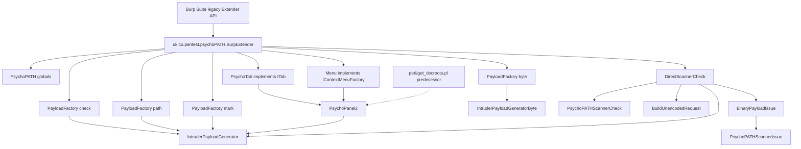

# PathHunter architecture

PathHunter is a single Burp entry class, a Swing tab, and one payload engine reused by Intruder, by the Save/Copy buttons, and by the active Scanner check. There is no separate service layer, no configuration file, and no database. All options live in `PsychoPanel2` fields and Swing models.

**User-facing brand:** PathHunter. **Technical Java package:** `uk.co.pentest.psychoPATH` (retained for compatibility; not renamed).

**Absolute paths (Phase 2.1):** When enabled on the Absolute paths tab, `IntruderPayloadGenerator.appendAbsolutePathPayloads` appends validated bare absolute filesystem paths (Linux / Windows / custom) after standard traversal construction and before terminator expansion. Helpers live in `AbsolutePathEngine`. Strategy tags on `psychoPayload` distinguish `STANDARD_TRAVERSAL` from absolute strategies.

## Diagram

## Load sequence

`uk.co.pentest.psychoPATH.BurpExtender.registerExtenderCallbacks` does the following, in order:

1. Stores `IBurpExtenderCallbacks` on `PsychoPATH.callbacks`.
2. Sets the extension name to **PathHunter**.
3. Constructs `PsychoTab`, which constructs `PsychoPanel2`. The panel immediately calls `callbacks.getStdout()` and writes a `PrintWriter`.
4. Adds the tab with `addSuiteTab` (caption **PathHunter**).
5. Registers the extender as an `IExtensionStateListener`. `extensionUnloaded` is empty.
6. Registers the four `PayloadFactory` instances.
7. Registers `DirectScannerCheck`.
8. Registers `Menu` as a context-menu factory.

`PsychoPATH` itself has no `main` behaviour beyond holding those two static fields. The checked-in historical jar still lists `Main-Class: uk.co.pentest.psychoPATH.PsychoPATH`. Burp does not use that attribute. It loads the Extender class named in the jar / Add Extension dialog: `uk.co.pentest.psychoPATH.BurpExtender`.
## Burp API surface actually used

The code implements or calls the legacy `burp.*` interfaces. It does not reference `burp.api.montoya`.

| Interface | Where |
| --- | --- |
| `IBurpExtender`, `IExtensionStateListener` | `BurpExtender` |
| `IBurpExtenderCallbacks` | Stored globally. Used for stdout, helpers, site map, tab, factories, scanner, menu, and `makeHttpRequest` in the scanner. |
| `ITab` | `PsychoTab` |
| `IIntruderPayloadGeneratorFactory`, `IIntruderAttack` | `PayloadFactory` |
| `IIntruderPayloadGenerator` | `IntruderPayloadGenerator`, `IntruderPayloadGeneratorByte` |
| `IScannerCheck`, `IScannerInsertionPoint`, `IHttpRequestResponse`, `IRequestInfo`, `IHttpService` | Scanner classes |
| `IScanIssue` | `PsychoPATHScannerIssue`, `BinaryPayloadIssue` |
| `IContextMenuFactory`, `IContextMenuInvocation` | `Menu` |
| `IExtensionHelpers` | `bytesToString`, `stringToBytes`, `analyzeRequest`, `buildHttpService`, `indexOf` |

`IBurpCollaboratorClientContext collabClient` is declared in `DirectScannerCheck` and never assigned or used.

## Payload engine phases

`IntruderPayloadGenerator` builds its whole list in the constructor when `payloadType` is `path` or `mark`. `check` only copies `PsychoPanel2.genericSuffixes`.

For `path` and `mark`:

1. Read the traversal spinner. Values below 1 are forced to 1.
2. Choose character tables for `.`, `/`, `\`, and the NUL terminator. The tables differ when "URL-encode UTF sequences" is selected. See `known-limitations.md` for the double-encoding consequence.
3. Build base units from the slash setting: `../` for nix, `..\` for Windows, and both plus `..\/` and `../\` when the setting is `all`.
4. Add a fully encoded copy of each base unit for every enabled encoding other than raw.
5. If mixed encodings are selected, walk each base unit and swap one character at a time into a second encoding.
6. If evasive techniques are on, expand the evasive list. `{BREAK}` is replaced by the decoded break-up strings and also by the hard-coded mixed-slash units `...\./` and `.../.\`. Encoded copies of those units are added.
7. Repeat each unit from one copy up to `maxTraversalsPerPayload`. The last repetition is kept as a "longest" traversal.
8. Choose file names. Intruder mode (`scanner=false`) uses `fileNameField` (default `etc/passwd`). Scanner mode uses `winFileName` and/or `nixFileName` according to the Target OS combo.
9. If LFI mode is off, expand document roots. `{TARGET}` is replaced from `targetsList`. Suffixes are the empty string, every target, and every entry in `suffixesList`.
10. Append file names to traversals. LFI optimisation keeps only the longest unit. Otherwise every length is used. If the file name contains `/` or `.`, the generator tries to reuse slash and dot spellings found inside the traversal.
11. If LFI mode is off, the same file names are also appended to `traversal + docroot + suffix`. When `useAbsoluteWebroots` is true, a second set is emitted without a leading traversal, and Windows paths that start with `C:` are rewritten for every drive in `drivesList`.
12. If terminators are on, each payload is copied with `%00` appended. A literal NUL is added only when "no literal null byte" is unchecked. Matching encoded terminators are added when the payload records a non-raw encoding index.

`getNextPayload` then returns:

- `path`: the string at `payloadIndex`, then increments.
- `mark`: the same index, zero-padded to 7 characters.
- `check`: `directoriesToCheck.get(payloadIndex)`.

The marker and the path stay aligned only when Intruder consumes them in lockstep, which is the pitchfork-style use shown in the original screenshots.

## Scanner path

`DirectScannerCheck.doActiveScan` returns immediately when the scanner checkbox is clear. Otherwise it builds an `IntruderPayloadGenerator("path", tab, true)`, so scanner file names are used. Each payload is placed into the insertion point by `BuildUnencodedRequest`, which plants a random alphanumeric canary of the same length and then overwrites it. That avoids Burp encoding the payload while building the request.

The response is converted to a string and searched for every entry in `scannerMatchRules`. The first hit raises one `BinaryPayloadIssue` and stops. `consolidateDuplicateIssues` returns `-1`.

`passiveScan` returns null.

## UI and configuration

There is no properties file. `PsychoPanel2` is both the view and the configuration object. Lists are Swing `ListModel`s. The generator reads those models at construction time, so a payload set is a snapshot taken when Intruder creates the generator, except the directory checker, which keeps the `genericSuffixes` list reference.

`Menu` adds "Propagate to PathHunter". On mouse release it reads the first selected message and calls `PsychoPanel2.updateScope(protocol, host)`. That method:

- stores protocol and host
- replaces the target list with the hostname
- attempts to add dotted labels
- clears `genericSuffixes`
- fills `genericSuffixes` from `callbacks.getSiteMap`, skipping responses whose status code is 404
- copies those paths, with the last segment removed, into `suffixesList`

## Directory and package layout

All extension **implementation** sources live under `Java/src/uk/co/pentest/` with `package uk.co.pentest.psychoPATH`. No project class remains in `package burp` (Phase 0.1); only allowlisted `burp.*` **API interfaces** are imported from the Burp runtime. The directory is `uk/co/pentest`, without a `psychoPATH` folder. `javac` accepts that when the files are passed explicitly. Class files are emitted under `uk/co/pentest/psychoPATH/`, matching the package.

## Error handling

There is no shared error type. Failures are local:

- Scanner request build failures are logged with `java.util.logging` and the request is left null, which can then throw when `makeHttpRequest` is called.
- File chooser failures log and return.
- `BuildUnencodedRequest` throws `Exception` when the canary is missing or duplicated.
- `BinaryPayloadIssue.getHost`, `getPort`, and `getProtocol` throw `UnsupportedOperationException`.
- `IntruderPayloadGeneratorByte` throws `NullPointerException` when `byteGeneratorRange` matches none of the known range names, because `bytes_raw` stays null. The smoke harness observed that exception.
- `updateScope` throws `NullPointerException` if `getSiteMap` returns null. The first harness run observed that at `PsychoPanel2.java:190`. Burp's own implementation returns an array; the NPE is the behaviour of a null return.
- `getNextPayload` on an empty directory-checker list throws `IndexOutOfBoundsException`. The harness observed that.
- `extensionUnloaded` does nothing.
- `payloadCount()` always returns 0 and is unused by the load path.
